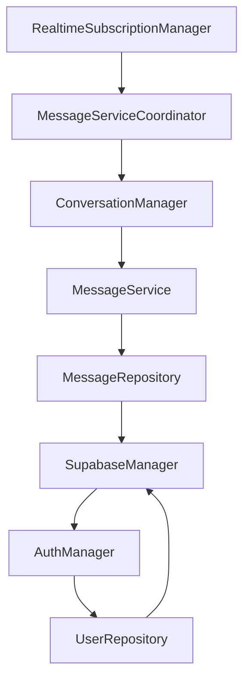
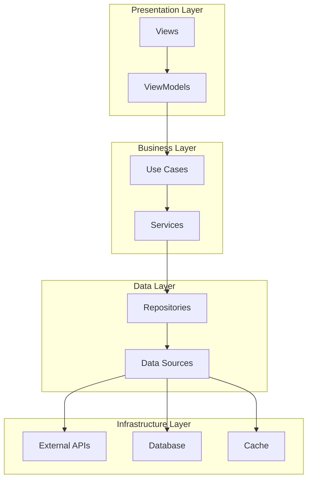

# STILL iOS アプリ アーキテクチャ改善計画

## 🏗️ 現在のアーキテクチャ分析

### アーキテクチャ概要
STILLアプリは**機能ベースアーキテクチャ**を採用していますが、一貫性のない実装パターンと循環依存の問題があります。

```
still/
├── Core/              # 共通コンポーネント
├── Features/          # 機能別モジュール
├── SharedViews/       # 再利用可能なUI
└── Resources/         # リソースファイル
```

## 🔴 現在の主要な問題点

### 1. 混在するアーキテクチャパターン

#### 問題：複数のViewModelパターンが混在
```swift
// パターン1: BaseViewModelClass 継承
class MessagesViewModel: BaseViewModelClass {
    // 実装...
}

// パターン2: BaseViewModel プロトコル実装
class ProfileViewModel: ObservableObject, BaseViewModel {
    // 実装...
}

// パターン3: 直接 ObservableObject 実装
class CameraViewModel: ObservableObject {
    // 実装...
}
```

### 2. 循環依存の問題

#### 発見された依存関係の問題


### 3. 責任分離の欠如

#### God Object の例
```swift
// MessagesViewModel.swift - 496行
class MessagesViewModel: BaseViewModelClass {
    // UI状態管理
    @Published var messages: [Message] = []
    @Published var isLoading = false
    @Published var errorMessage: String?
    
    // ビジネスロジック
    func sendMessage() { }
    func loadConversations() { }
    func markAsRead() { }
    
    // データアクセス
    func fetchFromDatabase() { }
    func uploadToStorage() { }
    
    // 暗号化処理
    func encryptMessage() { }
    func decryptMessage() { }
    
    // リアルタイム通信
    func setupSubscriptions() { }
    func handleRealtimeUpdates() { }
}
```

---

## 🎯 目標アーキテクチャ：Clean Architecture + MVVM

### 設計原則
1. **単一責任原則** - 各クラスは1つの責任のみ
2. **依存性逆転** - 抽象に依存し、具体に依存しない
3. **インターフェース分離** - 必要な機能のみを公開
4. **開放閉鎖原則** - 拡張に開放、修正に閉鎖

### レイヤー構造


---

## 🔧 段階的改善計画

### Phase 1: ViewModel標準化

#### 統一BaseViewModelの実装
```swift
// BaseViewModel.swift
@MainActor
protocol BaseViewModel: ObservableObject {
    associatedtype State: ViewModelState
    associatedtype Action: ViewModelAction
    
    var state: State { get }
    var isLoading: Bool { get }
    var error: AppError? { get }
    
    func send(_ action: Action) async
    func clearError()
}

// ViewModelState.swift
protocol ViewModelState {
    var isLoading: Bool { get set }
    var error: AppError? { get set }
}

// ViewModelAction.swift
protocol ViewModelAction {
    // マーカープロトコル
}
```

#### 具体的な実装例
```swift
// MessagesViewModel.swift - 改善版
@MainActor
class MessagesViewModel: BaseViewModel {
    
    // MARK: - State
    struct State: ViewModelState {
        var messages: [Message] = []
        var conversations: [Conversation] = []
        var selectedConversation: Conversation?
        var isLoading = false
        var error: AppError?
    }
    
    // MARK: - Actions
    enum Action: ViewModelAction {
        case loadConversations
        case selectConversation(Conversation)
        case sendMessage(String)
        case markAsRead(String)
    }
    
    // MARK: - Dependencies
    private let messageUseCase: MessageUseCase
    private let conversationUseCase: ConversationUseCase
    
    @Published private(set) var state = State()
    
    // MARK: - Computed Properties
    var isLoading: Bool { state.isLoading }
    var error: AppError? { state.error }
    
    // MARK: - Initialization
    init(
        messageUseCase: MessageUseCase,
        conversationUseCase: ConversationUseCase
    ) {
        self.messageUseCase = messageUseCase
        self.conversationUseCase = conversationUseCase
    }
    
    // MARK: - Actions
    func send(_ action: Action) async {
        switch action {
        case .loadConversations:
            await loadConversations()
        case .selectConversation(let conversation):
            await selectConversation(conversation)
        case .sendMessage(let content):
            await sendMessage(content)
        case .markAsRead(let conversationId):
            await markAsRead(conversationId)
        }
    }
}
```

### Phase 2: Use Case層の導入

#### Use Caseの実装
```swift
// MessageUseCase.swift
protocol MessageUseCase {
    func sendMessage(_ content: String, to conversationId: String) async throws -> Message
    func loadMessages(for conversationId: String) async throws -> [Message]
    func markMessagesAsRead(in conversationId: String) async throws
}

class MessageUseCaseImpl: MessageUseCase {
    private let messageRepository: MessageRepository
    private let encryptionService: EncryptionService
    private let realtimeService: RealtimeService
    
    init(
        messageRepository: MessageRepository,
        encryptionService: EncryptionService,
        realtimeService: RealtimeService
    ) {
        self.messageRepository = messageRepository
        self.encryptionService = encryptionService
        self.realtimeService = realtimeService
    }
    
    func sendMessage(_ content: String, to conversationId: String) async throws -> Message {
        // 1. 暗号化
        let encryptedContent = try await encryptionService.encrypt(content)
        
        // 2. メッセージ作成
        let message = Message(
            content: encryptedContent,
            conversationId: conversationId,
            senderId: getCurrentUserId()
        )
        
        // 3. 保存
        let savedMessage = try await messageRepository.save(message)
        
        // 4. リアルタイム送信
        await realtimeService.broadcast(savedMessage)
        
        return savedMessage
    }
}
```

### Phase 3: Repository層の整理

#### 統一Repositoryインターフェース
```swift
// Repository.swift
protocol Repository {
    associatedtype Entity: Identifiable
    associatedtype ID: Hashable
    
    func find(by id: ID) async throws -> Entity?
    func findAll() async throws -> [Entity]
    func save(_ entity: Entity) async throws -> Entity
    func delete(by id: ID) async throws
}

// MessageRepository.swift
protocol MessageRepository: Repository where Entity == Message, ID == String {
    func findByConversation(_ conversationId: String) async throws -> [Message]
    func markAsRead(_ messageIds: [String]) async throws
}

class MessageRepositoryImpl: MessageRepository {
    private let dataSource: MessageDataSource
    private let cache: CacheManager
    
    func findByConversation(_ conversationId: String) async throws -> [Message] {
        // 1. キャッシュから確認
        if let cachedMessages = await cache.get(key: "messages_\(conversationId)") {
            return cachedMessages
        }
        
        // 2. データソースから取得
        let messages = try await dataSource.fetchMessages(for: conversationId)
        
        // 3. キャッシュに保存
        await cache.set(key: "messages_\(conversationId)", value: messages)
        
        return messages
    }
}
```

### Phase 4: 依存性注入システム

#### DI Container の拡張
```swift
// DependencyContainer.swift
protocol DependencyContainer {
    // Use Cases
    var messageUseCase: MessageUseCase { get }
    var conversationUseCase: ConversationUseCase { get }
    var userUseCase: UserUseCase { get }
    
    // Repositories
    var messageRepository: MessageRepository { get }
    var userRepository: UserRepository { get }
    
    // Services
    var encryptionService: EncryptionService { get }
    var realtimeService: RealtimeService { get }
}

class DependencyContainerImpl: DependencyContainer {
    // MARK: - Lazy Properties
    lazy var messageUseCase: MessageUseCase = MessageUseCaseImpl(
        messageRepository: messageRepository,
        encryptionService: encryptionService,
        realtimeService: realtimeService
    )
    
    lazy var messageRepository: MessageRepository = MessageRepositoryImpl(
        dataSource: messageDataSource,
        cache: cacheManager
    )
    
    // MARK: - Private Dependencies
    private lazy var messageDataSource = MessageDataSourceImpl(supabase: supabaseClient)
    private lazy var cacheManager = CacheManagerImpl()
    private lazy var supabaseClient = SupabaseManager.shared.client
}
```

---

## 🔄 リファクタリング戦略

### 1. Strangler Fig Pattern

既存のコードを段階的に置き換える戦略：

```swift
// 段階1: 新しいインターフェースを作成
protocol NewMessageService {
    func sendMessage(_ content: String) async throws -> Message  
}

// 段階2: アダプターで既存システムをラップ
class MessageServiceAdapter: NewMessageService {
    private let legacyService: LegacyMessageService
    
    func sendMessage(_ content: String) async throws -> Message {
        // 必要に応じて新旧の処理を組み合わせ
        return try await legacyService.sendMessage(content)
    }
}

// 段階3: 新しい実装に徐々に移行
class NewMessageServiceImpl: NewMessageService {
    func sendMessage(_ content: String) async throws -> Message {
        // 新しいクリーンな実装
    }
}
```

### 2. Feature Toggle Pattern

```swift
// FeatureFlags.swift
struct FeatureFlags {
    static let useNewMessageSystem = false
    static let useNewUserInterface = false
    static let enableAdvancedEncryption = false
}

// 使用例
class MessagesView: View {
    var body: some View {
        if FeatureFlags.useNewMessageSystem {
            NewMessagesView()
        } else {
            LegacyMessagesView()
        }
    }
}
```

---

## 📊 移行スケジュール

### Week 1-2: Foundation (基盤構築)
- [ ] BaseViewModel プロトコルの実装
- [ ] AppError 統一エラー型の実装
- [ ] DependencyContainer の拡張
- [ ] FeatureFlags システムの導入

### Week 3-4: Use Cases (ビジネスロジック層)
- [ ] MessageUseCase の実装
- [ ] ConversationUseCase の実装
- [ ] UserUseCase の実装
- [ ] PostUseCase の実装

### Week 5-6: Repository Refactoring (データアクセス層)
- [ ] 統一Repository インターフェースの実装
- [ ] MessageRepository のリファクタリング
- [ ] UserRepository のリファクタリング
- [ ] キャッシュシステムの統合

### Week 7-8: ViewModel Migration (プレゼンテーション層)
- [ ] MessagesViewModel の移行
- [ ] ProfileViewModel の移行
- [ ] CreatePostViewModel の移行
- [ ] 残りのViewModelの移行

### Week 9-10: Service Layer Cleanup (サービス層整理)
- [ ] 循環依存の解決
- [ ] サービス境界の明確化
- [ ] インターフェース分離の適用
- [ ] レガシーコードの削除

---

## 🧪 テスト戦略

### Unit Tests (単体テスト)

#### Use Case テスト
```swift
class MessageUseCaseTests: XCTestCase {
    var useCase: MessageUseCase!
    var mockRepository: MockMessageRepository!
    var mockEncryption: MockEncryptionService!
    
    override func setUp() {
        mockRepository = MockMessageRepository()
        mockEncryption = MockEncryptionService()
        useCase = MessageUseCaseImpl(
            messageRepository: mockRepository,
            encryptionService: mockEncryption,
            realtimeService: MockRealtimeService()
        )
    }
    
    func testSendMessage() async throws {
        // Given
        let content = "Test message"
        let conversationId = "conv-123"
        
        // When
        let result = try await useCase.sendMessage(content, to: conversationId)
        
        // Then
        XCTAssertEqual(result.content, "encrypted_content")
        XCTAssertTrue(mockRepository.saveCalled)
    }
}
```

#### ViewModel テスト
```swift
class MessagesViewModelTests: XCTestCase {
    var viewModel: MessagesViewModel!
    var mockUseCase: MockMessageUseCase!
    
    func testSendMessageAction() async {
        // Given
        let message = "Hello"
        
        // When
        await viewModel.send(.sendMessage(message))
        
        // Then
        XCTAssertFalse(viewModel.isLoading)
        XCTAssertNil(viewModel.error)
        XCTAssertTrue(mockUseCase.sendMessageCalled)
    }
}
```

### Integration Tests (統合テスト)
```swift
class MessageFlowIntegrationTests: XCTestCase {
    
    func testCompleteMessageFlow() async throws {
        // 実際のDIコンテナを使用した統合テスト
        let container = TestDependencyContainer()
        let viewModel = MessagesViewModel(
            messageUseCase: container.messageUseCase,
            conversationUseCase: container.conversationUseCase
        )
        
        // メッセージ送信フロー全体をテスト
        await viewModel.send(.sendMessage("Integration test"))
        
        // 結果検証
        XCTAssertFalse(viewModel.isLoading)
        XCTAssertNil(viewModel.error)
    }
}
```

---

## 📈 成功指標

### コード品質メトリクス
- **循環依存**: 0個（現在: 5個以上）
- **平均クラス行数**: 200行以下（現在: 400行以上）
- **責任数**: 1クラス1責任（現在: 複数責任のクラス多数）
- **テストカバレッジ**: 85%以上（現在: 60%未満）

### パフォーマンスメトリクス
- **起動時間**: 30%短縮
- **メモリ使用量**: 20%削減
- **CPU使用率**: 15%削減
- **ネットワーク効率**: 25%向上

### 保守性メトリクス
- **新機能開発時間**: 40%短縮
- **バグ修正時間**: 50%短縮
- **コードレビュー時間**: 30%短縮
- **新人のオンボーディング**: 1週間以内

---

## 🚀 実装ガイドライン

### コーディング規約
```swift
// MARK: - Good Examples

// ✅ 単一責任の Use Case
protocol MessageUseCase {
    func sendMessage(_ content: String, to conversationId: String) async throws -> Message
}

// ✅ 依存性注入による疎結合
class MessagesViewModel: BaseViewModel {
    private let messageUseCase: MessageUseCase // プロトコルに依存
    
    init(messageUseCase: MessageUseCase) {
        self.messageUseCase = messageUseCase
    }
}

// ✅ 明確な層分離
struct MessageEntity { } // Data Layer
class MessageUseCase { } // Business Layer  
class MessagesViewModel { } // Presentation Layer
```

### アンチパターンの回避
```swift
// MARK: - Anti-patterns to avoid

// ❌ シングルトンの直接参照
class BadViewModel {
    func loadData() {
        SupabaseManager.shared.fetchData() // 避ける
    }
}

// ❌ 混在した責任
class BadService {
    func sendMessage() { } // ビジネスロジック
    func saveToDatabase() { } // データアクセス
    func updateUI() { } // プレゼンテーション
}

// ❌ 強結合
class BadRepository {
    private let specificService = SpecificService() // 具体クラスに依存
}
```

---

*最終更新日: 2025年1月4日*
*プロジェクト: STILL iOS アプリ - アーキテクチャ改善計画*